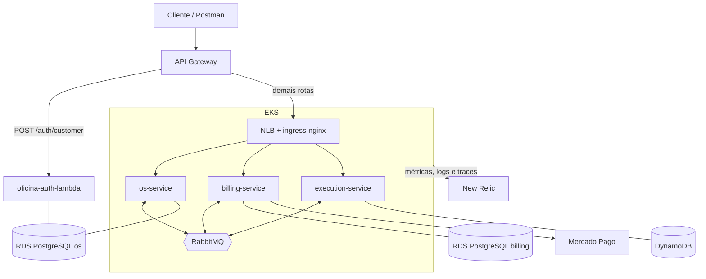

# oficina-infra-k8s

Infraestrutura base do Sistema Integrado de Atendimento e Execução de Serviços da oficina, provisionada com Terraform na AWS, e o ambiente local completo.

## Visão geral da solução



| Repositório | Conteúdo |
|---|---|
| `oficina-os-service` | Cadastros, estoque, ordem de serviço e orquestrador da Saga (PostgreSQL) |
| `oficina-billing-service` | Orçamento e pagamento via Mercado Pago (PostgreSQL) |
| `oficina-execution-service` | Fila de execução, diagnóstico e reparo (DynamoDB) |
| `oficina-auth-lambda` | Autenticação do cliente por CPF |
| `oficina-infra-k8s` | Este repositório: rede, cluster, API Gateway, mensageria e observabilidade |
| `oficina-infra-db` | Bancos gerenciados (RDS e DynamoDB) |

**Divisão dos microsserviços:** cada serviço corresponde a uma área da oficina com ciclo de vida e regras próprias — atendimento (OS), cobrança (billing) e produção (execution). Nenhum serviço acessa o banco de outro; a integração é feita por mensagens no RabbitMQ, coordenadas pela Saga orquestrada no `os-service`.

## Recursos criados por este repositório

| Arquivo | Recursos |
|---|---|
| `network.tf` | VPC, duas subnets públicas, internet gateway e rotas |
| `eks.tf` | Cluster EKS, node group com auto scaling, roles IAM, EKS Pod Identity com a role de acesso ao DynamoDB do execution-service e repositórios ECR dos três microsserviços |
| `platform.tf` | Namespaces `oficina-hml` e `oficina-prod`, metrics-server (necessário para o HPA), ingress-nginx com NLB e o bundle do New Relic |
| `messaging.tf` | RabbitMQ no namespace `messaging` |
| `api-gateway.tf` | API Gateway HTTP API roteando para o ingress do cluster, com logs de acesso |

O RabbitMQ roda com uma réplica e sem volume persistente, o suficiente para o trabalho acadêmico. Em produção real, o recomendado é o Amazon MQ ou o operador do RabbitMQ com armazenamento persistente.

## Ordem de provisionamento

1. `oficina-infra-k8s` (este repositório)
2. `oficina-infra-db`
3. `oficina-auth-lambda`
4. Os três microsserviços

Antes de tudo, crie um bucket S3 para o estado do Terraform e informe o nome na variável `TF_STATE_BUCKET` de cada repositório.

## Provisionamento com Terraform

Pela pipeline: todo pull request roda `fmt`, `validate` e `plan`; o merge em `main` aplica.

| Tipo | Nome |
|---|---|
| Secrets | `AWS_ACCESS_KEY_ID`, `AWS_SECRET_ACCESS_KEY`, `RABBITMQ_PASSWORD`, `NEW_RELIC_LICENSE_KEY` |
| Variables | `AWS_REGION`, `TF_STATE_BUCKET` |

Manualmente:

```bash
terraform init -backend-config="bucket=<bucket>" -backend-config="region=us-east-1"
```

```bash
terraform apply -var rabbitmq_password=<senha> -var new_relic_license_key=<chave>
```

Saídas: `api_url` (URL pública do API Gateway), `cluster_name`, `ecr_repositories` e `rabbitmq_host`. A `RABBITMQ_URL` dos microsserviços fica `amqp://oficina:<senha>@rabbitmq.messaging.svc.cluster.local:5672`.

Para destruir tudo e parar a cobrança, remova primeiro os microsserviços e a Lambda e depois rode `terraform destroy` em `oficina-infra-db` e neste repositório.

## Ambientes

| Branch | Namespace | Prefixo das rotas |
|---|---|---|
| `develop` | `oficina-hml` | `/hml` |
| `main` | `oficina-prod` | — |

As branches `main` e `develop` devem ser protegidas no GitHub, exigindo pull request e a checagem `quality` (ou `terraform`) antes do merge.

## Escalabilidade

Cada microsserviço tem um HPA (2 a 6 réplicas, 70% de CPU ou 80% de memória) e o node group escala de 2 a 4 nós. Para demonstrar:

```bash
kubectl get hpa -n oficina-prod -w
```

```bash
kubectl run load --rm -it --image=busybox -n oficina-prod -- sh -c "while true; do wget -q -O- http://oficina-os-service/health; done"
```

## Observabilidade (New Relic)

- **Kubernetes:** o bundle `nri-bundle` coleta CPU e memória de nós e pods, eventos e logs do cluster.
- **APM:** os três microsserviços carregam o agente quando `NEW_RELIC_LICENSE_KEY` está definido, com latência por rota e distributed tracing entre HTTP e RabbitMQ.
- **Logs:** JSON com `correlationId`, que acompanha a requisição e todas as mensagens geradas por ela.
- **Healthchecks:** `/health` em cada serviço, usado nas probes e disponível para monitores sintéticos.

Consultas NRQL para os dashboards:

```sql
SELECT count(*) FROM ServiceOrderStatusChanged WHERE status = 'RECEIVED' FACET dateOf(timestamp) SINCE 1 week ago
```

```sql
SELECT average(secondsInPreviousStatus) / 60 FROM ServiceOrderStatusChanged FACET previousStatus SINCE 1 week ago
```

```sql
SELECT count(*) FROM IntegrationFailure FACET integration TIMESERIES SINCE 1 day ago
```

```sql
SELECT count(*) FROM ServiceOrderSagaCompensated FACET reason SINCE 1 day ago
```

A última consulta serve de base para o alerta de falhas no processamento de ordens de serviço.

## Ambiente local completo

Com os seis repositórios clonados lado a lado:

```bash
docker compose -f local/docker-compose.yml up --build
```

| Componente | Endereço |
|---|---|
| os-service | http://localhost:3001 (Swagger em `/docs/os`) |
| billing-service | http://localhost:3002 (Swagger em `/docs/billing`) |
| execution-service | http://localhost:3003 (Swagger em `/docs/execution`) |
| auth-lambda | http://localhost:3000/auth/customer |
| RabbitMQ | http://localhost:15672 (guest / guest) |
| E-mails | http://localhost:8025 |

Importe `docs/oficina.postman_collection.json` no Postman e execute as pastas na ordem. O login administrativo local é `admin@oficina.com` / `admin123`. Sem credenciais do Mercado Pago, o pagamento é simulado pelo webhook, como descrito no README do `oficina-billing-service`.
